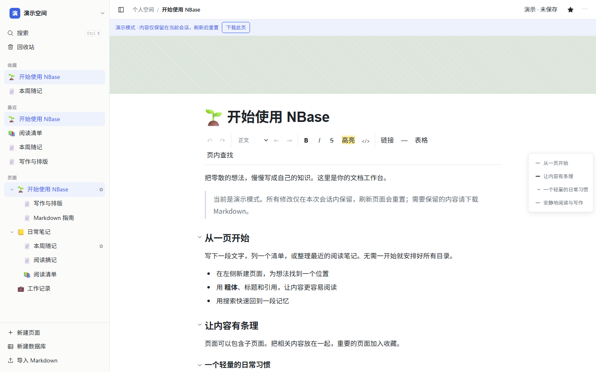
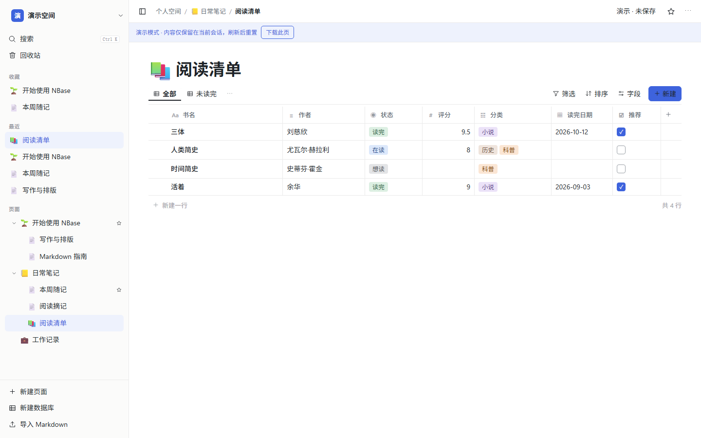
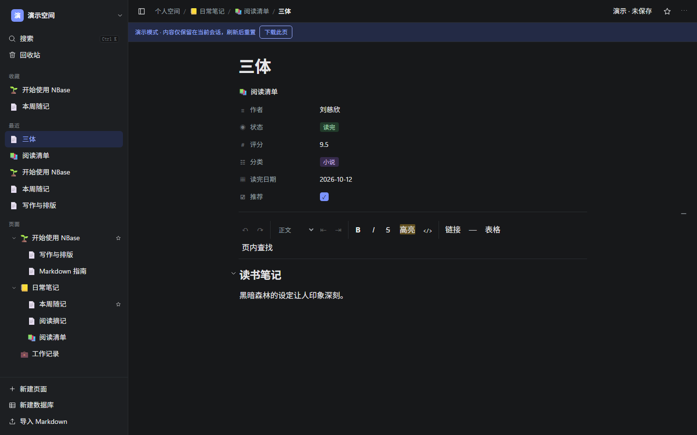

# NBase

自部署的文档工作台。浏览器访问本机 Fastify 服务，文档正文和账号保存在 PostgreSQL，附件文件保存在独立目录。项目范围、实施进度与验证结论分别见 [V1 文档需求](docs/product/v1-documents.md)、[计划](docs/plan.md)和[验证记录](docs/validation.md)。

## 项目演示

截图来自 NBase 的内置演示工作台。

### 文档编辑

通过左侧页面树组织文档，使用富文本工具栏编辑，或用右侧大纲跳转到各节。



### 多维表格

阅读清单展示状态、评分、分类和日期等字段，可切换视图、筛选和排序。



### 行页面

表格中的每条记录都可以打开为页面，在结构化属性下方写正文。



## 本地开发

需要 Node.js 24.x、npm 11.x。默认只监听回环地址。

```sh
npm ci
npm run dev
```

打开 `http://127.0.0.1:5173/`。不配置数据库时，网页明确标识为会话演示，刷新后重置。持久化工作台需要独立的 PostgreSQL 数据库、精确的 `NBASE_PUBLIC_ORIGIN` 和已存在、可写的绝对路径 `NBASE_ATTACHMENT_DIR`。`npm start` 不会自动读取 `.env` 文件。

```sh
npm run check       # 类型检查、服务端与网页测试、构建
npm run build
npm start           # 构建后的网页和 API 默认在 127.0.0.1:3001
```

数据库初始化、隔离本机容器和附件目录配置见 [本机 PostgreSQL](docs/architecture/local-postgres.md)与[附件契约](docs/architecture/attachments.md)。服务启动时校验迁移和附件目录；`/api/health` 仅说明进程存活，不代表数据可恢复或适合正式使用。

## Docker 持久化部署

根目录 `compose.yaml` 提供应用、独立 PostgreSQL 和附件命名卷，默认只发布本机端口。初始化、密码恢复、会话撤销和故障处理见 [部署与维护](docs/architecture/deployment.md)。成套备份、空目标恢复和升级回退操作见 [备份与恢复](docs/architecture/backup-recovery.md)；日用与目标环境验收继续按 [计划](docs/plan.md)推进。

```sh
node -- scripts/setup-docker.mjs
docker compose --env-file .env.docker build nbase
docker compose --env-file .env.docker up -d --wait postgres
docker compose --env-file .env.docker run --rm admin
docker compose --env-file .env.docker up -d --wait nbase
```

## 文档入口

- [已确认需求与沟通记录](docs/product/requirements.md)
- [V1 文档范围与验收](docs/product/v1-documents.md)
- [技术选型与架构决定](docs/architecture/decisions.md)
- [Markdown 支持矩阵](docs/product/markdown-support.md)
- [附件存储与交换契约](docs/architecture/attachments.md)
- [实施计划](docs/plan.md)
- [验证记录](docs/validation.md)
- [架构与开发规范](AGENT.md)与 [Agent 执行规则](AGENTS.md)

项目最终分发许可证尚未决定。当前包标记为 private / UNLICENSED；新增依赖应核对许可证并锁定版本。
