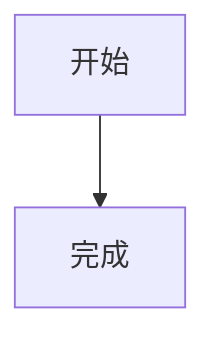
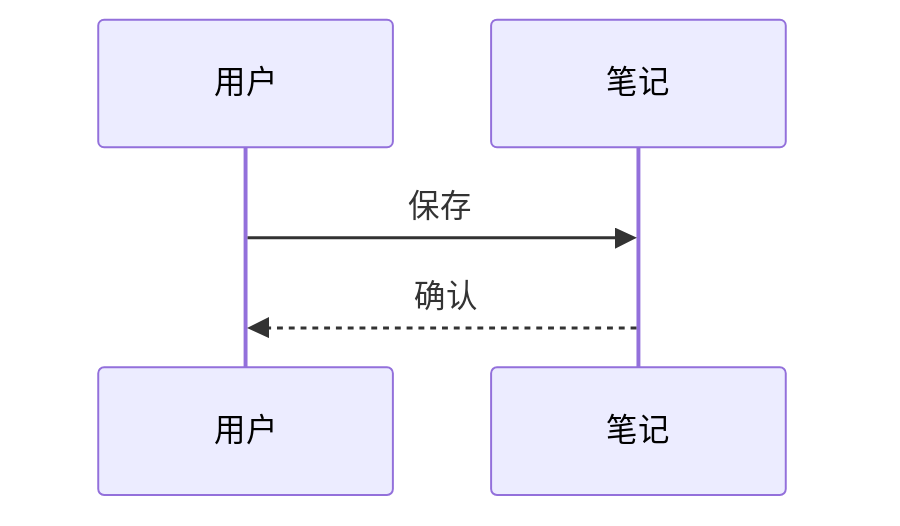

# 阅读与编辑

中文 **粗体**、*斜体*、==高亮==、字面 \=\=、`a == b` 和 $x^2$。

> [!NOTE] 可选标题
> 提示块内有 **格式** 和 [链接][guide]。

- [ ] 第一项
- [x] 第二项

| 左列 | 中列 | 右列 |
| :--- | :---: | ---: |
| 中文 | 空白 | \| |

```typescript
const equals = '==';
```

$$
\sum_{i=1}^{n} i
$$

重复引用脚注[^why]，再次引用[^why]。

[^why]: 这是脚注的 **正文**。





[guide]: https://example.com/guide "参考"
